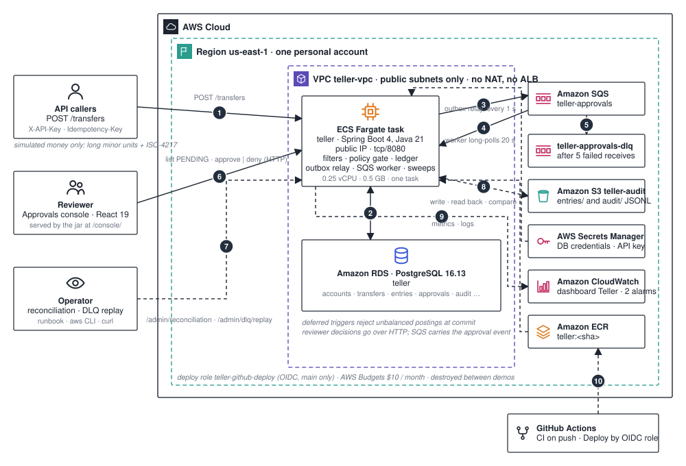

# Architecture

Teller is a simulated payments core built as a portfolio project. It moves no real money. It keeps money as `long` minor units plus an ISO-4217 currency, posts balanced double-entry ledger rows, reserves funds for four-eyes approval, and checks its own correctness under seeded transport and process faults.

This page is the map: the parts, where they run, and the path one transfer takes through them. The numbers on the diagram match the list below. The reasons behind the design are in the [ADRs](./adr/); the alarm playbooks are in [`runbook.md`](./runbook.md); the measured runs are under [`evidence/`](./evidence/).

## The path of one transfer

1. **API caller → the service.** `POST /transfers` arrives with `X-API-Key` (checked in constant time) and an `Idempotency-Key`. `IdempotencyService` claims the key in `idempotency_records`; a replay with the same body returns the stored response, a replay with a different body returns 409.
2. **Service ↔ PostgreSQL.** `TransferService` locks both accounts in UUID order, asks the policy gate (`PolicyCache` plus `RulesEngine`: lowest precedence first, first match wins, no match is `DENY`), and stores an immutable `decisions` row. Then one commit does one of three things. `ALLOW` posts the debit and credit `entries` and marks the transfer `POSTED`. `DENY` marks it `DENIED` and moves nothing. `REQUIRE_APPROVAL` reserves the amount from the available balance, marks the transfer `HELD`, and inserts an `approvals` row (30 minute TTL) together with an `outbox_messages` row. `DEFERRABLE INITIALLY DEFERRED` triggers reject any unbalanced posting at commit, and the available balance is always the ledger balance minus active holds.
3. **Service → Amazon SQS.** `OutboxRelay` runs every second and publishes each unsent `ApprovalMessage{messageId, approvalId, decisionId, expiresAt}` to `teller-approvals`, then records `sent_at`. The message id is stable across retries.
4. **Amazon SQS → the service.** `ApprovalQueueWorker` long-polls for 20 s. For each message it inserts into `processed_messages` and processes in one transaction, so a duplicate has no effect; a stale approval is expired; the message is then deleted.
5. **Amazon SQS → dead-letter queue.** A message that fails five receives moves to `teller-approvals-dlq` (visibility 60 s on AWS, 30 s on LocalStack; retention 4 days, 14 days on the DLQ). The `teller-approval-dlq-depth` alarm fires at one visible message.
6. **Reviewer → the service.** The React console, served by the jar at `/console/`, lists `GET /approvals?status=PENDING`, shows `GET /approvals/{id}/transfer`, and posts `POST /approvals/{id}/approve` or `/deny` with `decidedBy` and `reason`. This is HTTP, not SQS. `ApprovalService` hands the result to `TransferSettlementService`: approve consumes the reservation and posts the entries; deny releases it and the transfer becomes `REVERSED`. `ApprovalExpiryWorker` does the same for approvals that pass their TTL. Every step appends to `audit_records`.
7. **Operator → the service.** `POST /admin/reconciliation?date=` runs a reconciliation on demand; `POST /admin/dlq/replay` moves dead-lettered messages back, with an audit record. The replay endpoint exists only when `teller.aws.enabled=true`.
8. **Service ↔ Amazon S3.** `ReconciliationScheduler` (cron `0 5 0 * * *` UTC) writes `entries/dt=YYYY-MM-DD/run-<uuid>.jsonl` and `audit/dt=…/run-<uuid>.jsonl` to the versioned `teller-audit` bucket, reads the entries back, and compares identities, counts, per-currency totals and cached balances. The result lands in `reconciliation_runs`; a mismatch appends `RECONCILIATION_MISMATCH` and raises `teller.reconciliation.mismatch`.
9. **Service → Amazon CloudWatch.** Logs go to `teller-application` (kept one week). The `Teller` dashboard shows `teller.transfers.terminal`, `teller.reservations.active`, `teller.outbox.sent` and `teller.outbox.failed`. The `teller-http-5xx` alarm derives from the request logs.
10. **GitHub Actions → Amazon ECR.** CI runs on every push and pull request. Deploy is manual: it assumes `teller-github-deploy` through OIDC (trust limited to `repo:Aly700/teller:ref:refs/heads/main`), builds the image, pushes `teller:<sha>` and deploys the six application stacks. There are no static AWS keys anywhere.

## The simulation

The simulation needs no Spring context and no database:

1. `SimulationTest` wires the production services onto `InMemoryStores`; `Simulator` supplies a virtual `Clock` and a seeded event queue.
2. `FaultInjectingBus` stands in for SQS and injects crash-before-commit, crash-after-commit, delay, drop-then-redeliver, duplicate, reorder and visibility redelivery.
3. `Invariants.checkAfterStep()` runs after every event and `checkAfterQuiescence()` at the end.
4. `SimulationCoverage` writes `target/sim-coverage.json`; `-Dsim.seed=<n>` replays one trace.

## Components

| Component | Responsibility | Technology | Where to look |
| --- | --- | --- | --- |
| API callers | Transfers with idempotency; load generation | HTTP, k6 | `load/transfers.js` |
| Approvals console | Pending queue, approve and deny with reason, audit register; the API key lives in React memory only | React 19, Vite, served at `/console/` | `console/src/` |
| Teller service | REST API, policy gate, ledger, outbox relay, SQS worker, expiry worker, reconciliation scheduler, static console | Java 21, Spring Boot 4.1, JPA, Flyway, AWS SDK v2 | `src/main/java/dev/affan/teller/`, `Dockerfile` |
| PostgreSQL | Authoritative state: twelve tables with immutability and deferred balance triggers | `postgres:16-alpine` locally, RDS 16.13 `db.t4g.micro` on AWS | `src/main/resources/db/migration/` |
| Amazon SQS | `teller-approvals` and its dead-letter queue | SQS, LocalStack locally | `infra/lib/queue-stack.ts`, `localstack/init-aws.sh` |
| Amazon S3 | `teller-audit-<account>-<region>`, versioned, 365 day expiry | S3 | `infra/lib/bucket-stack.ts` |
| Secrets | `teller-database-credentials`, `teller-api-key` as ECS secrets | Secrets Manager | `infra/lib/data-stack.ts` |
| Compute | Cluster `teller-cluster`, service `teller-service`, one 0.25 vCPU / 0.5 GB task with a public IP on 8080; ECR repository `teller` | ECS Fargate | `infra/lib/service-stack.ts` |
| Observability | Log group, dashboard, two alarms | CloudWatch | `infra/lib/service-stack.ts` |
| Network | `teller-vpc`, two availability zones, public subnets only | VPC | `infra/lib/network-stack.ts` |
| CI/CD | CI on push; manual deploy by OIDC | GitHub Actions | `.github/workflows/`, `infra/lib/github-oidc-stack.ts` |
| Cost guard | `teller-monthly`, $10 | AWS Budgets | `infra/lib/budget-stack.ts` |

## Boundaries

- **Internet edge.** The task's public IP on tcp/8080, security group open to `0.0.0.0/0`. There is no ALB, WAF or TLS termination in the repository. Every endpoint needs the API key except `/actuator/health*` and `/console/**`.
- **Database.** RDS sits in the public subnets with `publiclyAccessible: false` and accepts 5432 only from the service's security group.
- **Task role.** Send and consume on the main queue, consume on the DLQ, `s3:GetObject` and `s3:PutObject` on `audit/*` and `entries/*`, read of `teller-api-key`. Database credentials and the API key arrive as ECS secrets, never in the image.
- **Persistence.** PostgreSQL holds all state. S3 holds immutable per-run exports. SQS is transport, not truth. CloudWatch keeps logs one week.
- **Local.** Compose runs the same image with `postgres:16-alpine` and LocalStack 3 (credentials `test`/`test`, profile `local`). The seven CDK stacks live in one personal account in `us-east-1` and are destroyed between demos.

## What is proven, and where

| Claim | Evidence |
| --- | --- |
| Money is exact minor units with a currency | [ADR 0001](./adr/0001-minor-units-and-currency.md) |
| Every posting balances; the database refuses an unbalanced commit | [ADR 0002](./adr/0002-balanced-entries-deferred-trigger.md), `LedgerIntegrationTest` |
| Available balance equals ledger minus active holds, under concurrent drains | [ADR 0003](./adr/0003-reservations-and-optimistic-locking.md) |
| Four-eyes approval is the `REQUIRE_APPROVAL` path of the shared policy gate | [ADR 0004](./adr/0004-policy-gate-reuse.md) |
| The simulation found a real missing-entry bug | [ADR 0005](./adr/0005-simulation-found-bug.md) |
| A killed task loses no approvals; a poison message reaches the DLQ and replays; expiries sweep at scale | [`evidence/chaos.md`](./evidence/chaos.md) |
| Throughput and latency at 0.5 vCPU | [`evidence/perf.md`](./evidence/perf.md) |
| The AWS deployment answers end to end; the deploy pipeline ran | [`evidence/aws-smoke.md`](./evidence/aws-smoke.md), [`evidence/pipeline.md`](./evidence/pipeline.md) |

The README reports the simulation campaign's totals (seeds, steps and transfers). The coverage file behind them is generated into `target/`, which is not committed, so rerun `SimulationTest` to regenerate it.

Out of scope by design: payment rails, KYC, FX, overdrafts, OAuth, Kafka or Kubernetes, a NAT gateway or a load balancer.

## Facts the code relies on

- Transfer states `PENDING`, `AUTHORIZED`, `HELD`, `DENIED`, `POSTED`, `REVERSED`; approval states `PENDING`, `APPROVED`, `DENIED`, `EXPIRED`; effects `ALLOW`, `DENY`, `REQUIRE_APPROVAL`; the policy tool name is `ledger.transfer`.
- Tables: `policies`, `rules`, `decisions`, `approvals`, `accounts`, `transfers`, `entries`, `audit_records`, `idempotency_records`, `outbox_messages`, `processed_messages`, `reconciliation_runs`.
- Ports 8080 (service), 5432 (PostgreSQL), 4566 (LocalStack). Environment: `DB_URL`, `DB_USERNAME`, `DB_PASSWORD`, `TELLER_API_KEY`, `TELLER_AWS_ENABLED`, `AWS_REGION`, `AWS_ENDPOINT_URL`, `APPROVAL_QUEUE_URL`, `APPROVAL_DLQ_URL`, `APPROVAL_WORKER_ENABLED`, `SQS_WAIT_TIME_SECONDS`, `AUDIT_BUCKET`, `AUDIT_EXPORT_ENABLED`, `AUDIT_EXPORT_CRON`, `APPROVAL_TTL`, `IDEMPOTENCY_TTL`.
